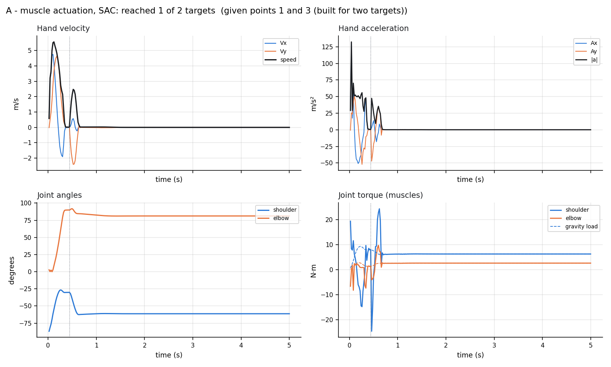
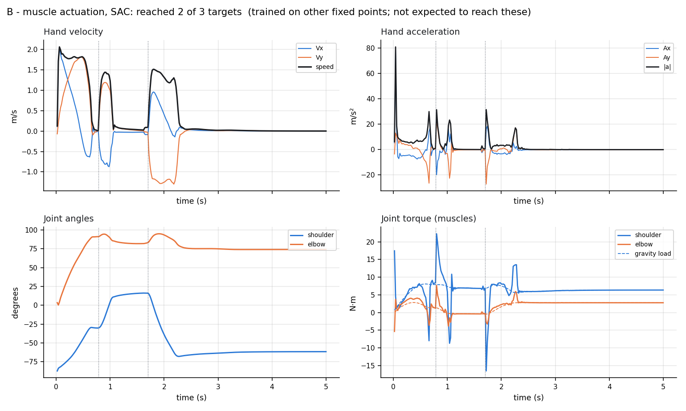
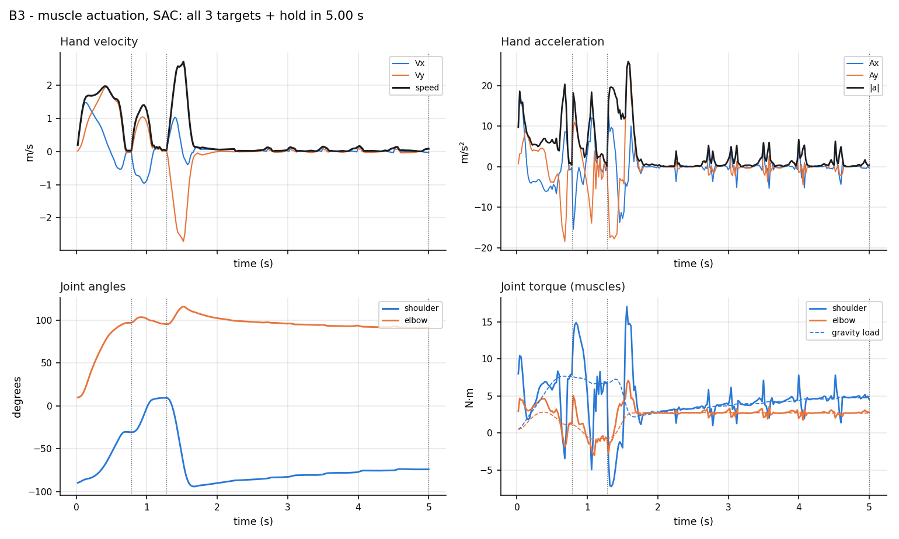
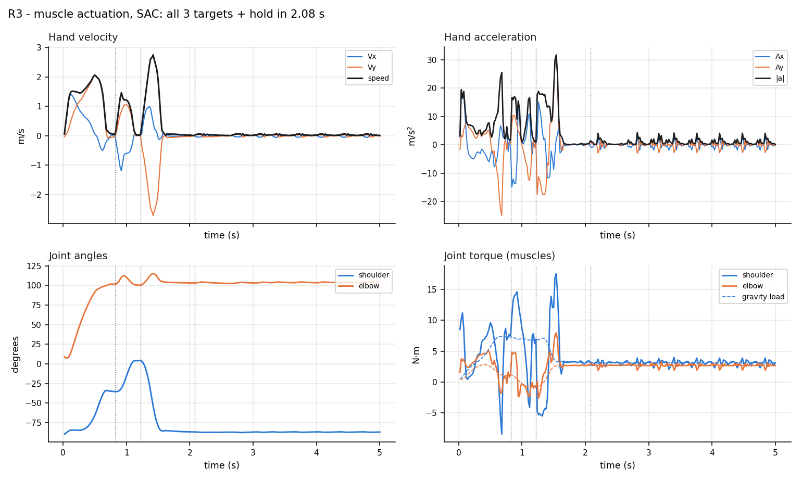
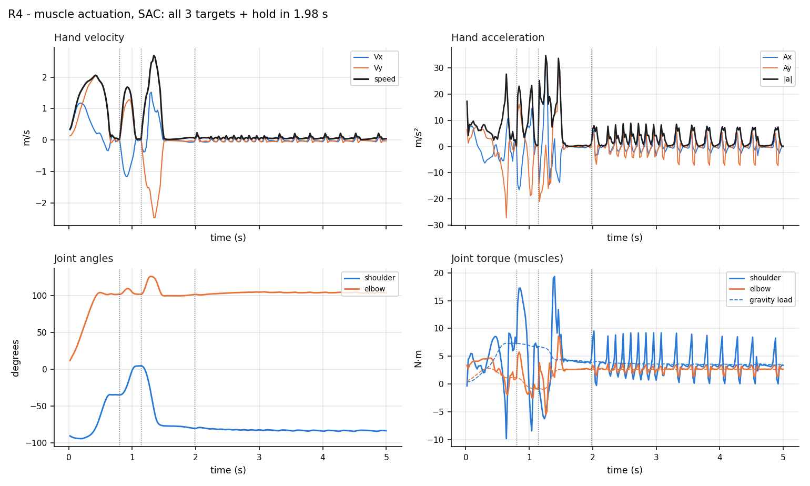
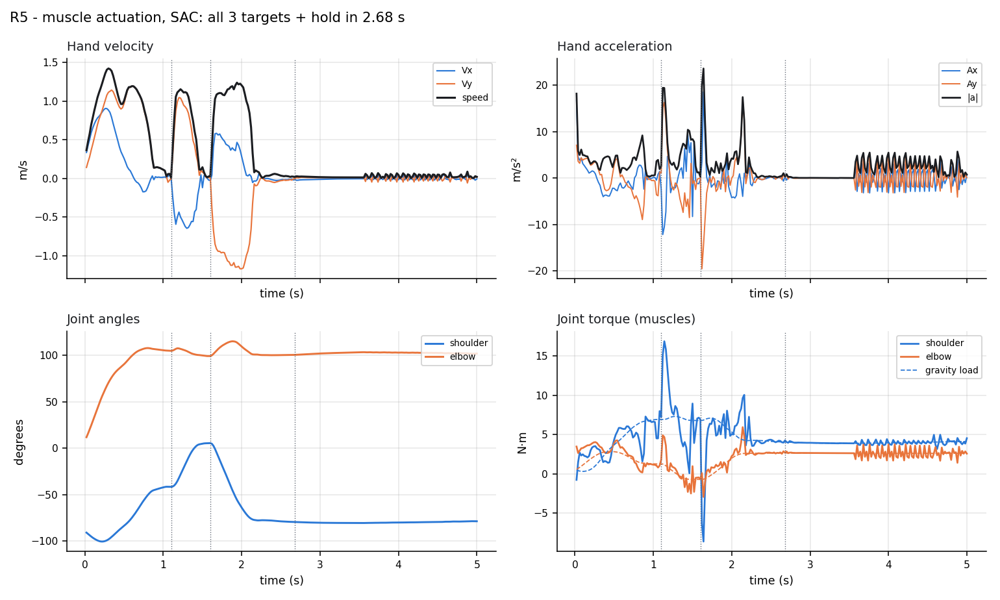
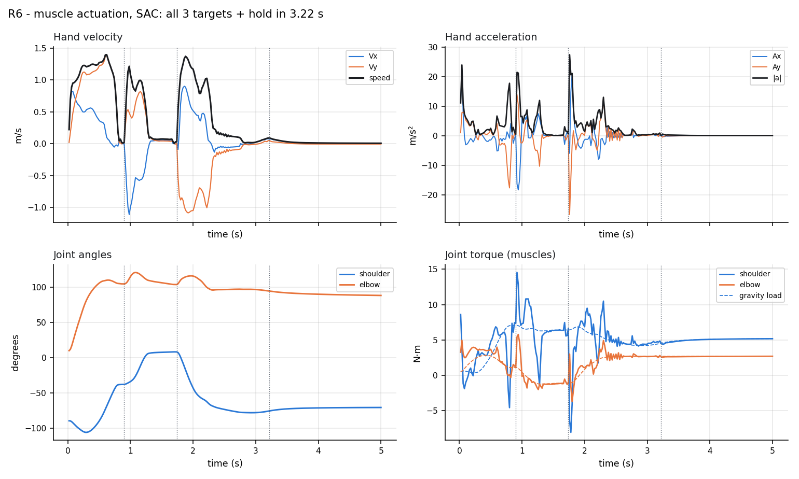
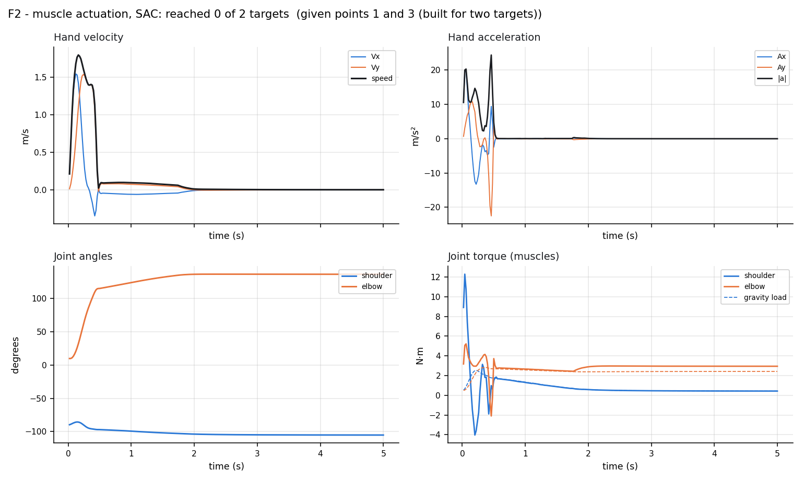
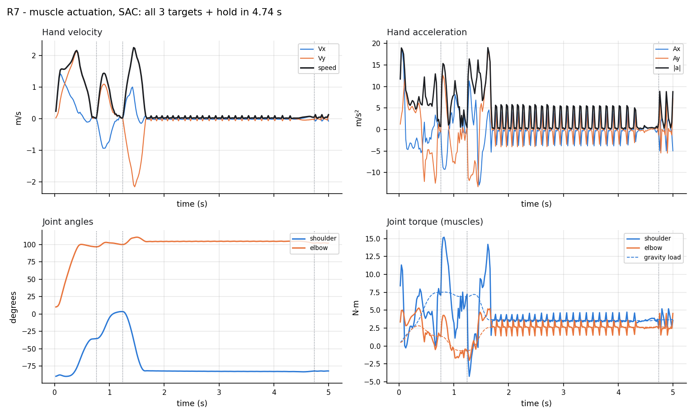

# Human-arm models: a study

*What each arm model does, how the models compare, what is wrong with each, muscles against torque actuators, cutting the training budget, and how reward weights change learning*

CP493 Directed Research — Wilfrid Laurier University · Ranjot Sandhu · October 2026

| models compared on the same tests | R7 (muscles) on the full human workspace | R8 (actuators) on the full human workspace | shared points for every model's profiles |
|---|---|---|---|
| **9** | **pending** | **pending** | **3** |

Every model in this study was trained from scratch by reinforcement learning (Soft Actor-Critic) to move a simulated two-joint human arm to target points and hold the last one still. They differ in one setting at a time: the task, the workspace, the reward, or — new in R8 — what drives the joints. Every number below was measured on the same tests, from files written by the measurement scripts.

## 1. The models at a glance

| Model | Drive | Trained to | What changed from the one before | Steps | Seeds |
|---|---|---|---|---|---|
| **A** | muscles | reach 2 fixed points (v1 set), hold at the second | first working model (a first attempt stalled with a straight arm) | 300K | 5 |
| **B** | muscles | reach 3 fixed points (v1 set), hold at the third | a third point | 600K | 5 |
| **B3** | muscles | reach 3 fixed points (v2 set, all well inside reach) | points moved inside the reach circle; muscle activation lag (40/60 ms) and a hand-acceleration penalty | 600K | 5 |
| **R3** | muscles | reach 3 RANDOM points per episode in the reach-margin region | random points every episode - the first model that generalises | 1.00M | 5 |
| **R4** | muscles | as R3 | targets that need an end-range posture are no longer drawn | 1.00M | 5 |
| **R5** | muscles | as R4 | hand-speed cost at human pace: cap 1.2 m/s, weight 10 | 1.00M | 5 |
| **R6** | muscles | as R4 | speed cost with a linear slope at the cap (linear 3 + quadratic 5) | 1.00M | 5 |
| **F2** | muscles | reach 2 random points in an order it chooses itself | free-order pilot: all targets visible at once, no ordering signal | 500K | 5 |
| **R7** | muscles | reach 3 random points anywhere a human arm can reach | targets limited only by the joint ranges (5° clear of each stop), not the 18 cm reach margin | 1.99M | 5 |
| **R8** | actuators | as R7, with joint-torque actuators | muscles replaced by shoulder and elbow torque motors | 20K | 5 |
| **R8E** | actuators | as R8 | 250-step training episodes (evaluation stays 500) | 20K | 3 |
| **R8N** | actuators | as R8 | 3-step returns | 20K | 3 |
| **R8U** | actuators | as R8 | 2 gradient updates per step | pending | — |
| **R8T** | actuators | as R8 | TQC instead of SAC | pending | — |
| **R8F** | actuators | as R8 | the step savers that worked, combined | pending | — |
| **R8FA** | actuators | as R8F | acceleration penalty saturates at 10 m/s² (ACCEL_REF 10 → 5) | pending | — |
| **R8FP** | actuators | as R8F | torque-rate penalty W_ACTION_RATE = 0.02 | pending | — |

**Families.** A, B and B3 memorise fixed points. R3–R6 reach random points in a region kept 18 cm inside the arm's reach. F2 chooses its own order. R7 covers the whole human workspace. R8 keeps R7's task and reward but replaces the four muscles with two torque motors; its variants (R8E, R8N, R8U, R8T, R8F) each change one training setting to cut the steps needed, and R8FA / R8FP change one reward weight.

## 2. How every model was measured

- **Final evaluation.** Each seed's best checkpoint, 20 fresh episodes at the production standard (5 cm tolerance, half-second hold), deterministic policy. Reported as mean ± standard deviation over seeds.
- **Full-workspace region test.** 200 three-target episodes drawn from the whole human workspace — the same episodes for every model — scored as whole episodes and per region (overhead, behind the body, hanging low, close in, the outer ring, and the old reach-margin area).
- **Clicked points.** 80 trials of three points chosen uniformly anywhere in reach, as a user would click them in the GUI; with a 95 % Wilson interval.
- **Human-likeness audit.** 30 episodes: hard limits (range of motion, speed, torque), hand speed against the human range, how often the speed cost is exceeded, peak torque, end-range use, hold drift, and co-contraction (muscles) or torque smoothness (actuators).
- **Profiles on three shared points.** Every model, the same start pose and the same three points (1.40, 0.15), (1.20, 0.40), (1.40, −0.20) m, for 5 s: hand velocity and acceleration, joint angles and joint torques.
- **Steps to 80 % (T80).** The first evaluation round (every 20,000 steps) at which success averaged over the last three rounds reaches 80 %. Measured on the fixed 10-episode evaluation set for every model; from R8 on, also on 10 fresh episodes per round (the probe), which cannot be overfitted.

## 3. Head-to-head

| Model | Final success (20 ep / seed) | Full workspace | Clicked points | Shared 3 points |
|---|---|---|---|---|
| **A** | 64% ± 50 (5 seeds) | pending | pending | 1 of 2 |
| **B** | 40% ± 55 (5 seeds) | pending | pending | 2 of 3 |
| **B3** | 100% ± 0 (5 seeds) | pending | pending | all 3 in 5.00 s |
| **R3** | 92% ± 6 (5 seeds) | pending | pending | all 3 in 2.08 s |
| **R4** | 97% ± 3 (5 seeds) | pending | pending | all 3 in 1.98 s |
| **R5** | 59% ± 41 (5 seeds) | pending | pending | all 3 in 2.68 s |
| **R6** | 78% ± 24 (5 seeds) | pending | pending | all 3 in 3.22 s |
| **F2** | 49% ± 12 (5 seeds) | pending | pending | 0 of 2 |
| **R7** | 81% ± 13 (5 seeds) | pending | pending | all 3 in 4.74 s |

*Figure 1. Final success of every seed (dots) and the mean (bar). Fixed-point models are scored on their own points; the random-point models on fresh random targets in the region they were trained on.*

### Movement quality (human-likeness audit, 30 episodes)

*Audit results pending.*

## 4. Profiles: every model on the same three points

Each model starts from the same pose and is given the same three points. Velocity and acceleration are of the hand (end effector); the torques are the net joint torques the drive applies — summed muscle torque for muscle models, the motor torque for actuator models.

| Model | Result | Peak speed | Peak accel. | RMS accel. | Steps > 10 / > 20 m/s² | Peak torque sh / el | RMS torque rate sh / el |
|---|---|---|---|---|---|---|---|
| **A** | 1/2 reached | 5.56 | 132 | 15.9 | 11% / 10% | 24.5 / 9.8 | 153 / 68 |
| **B** | 2/3 reached | 2.06 | 81 | 8.0 | 7% / 3% | 22.3 / 7.7 | 139 / 48 |
| **B3** | 5.00 s | 2.72 | 26 | 6.8 | 13% / 2% | 17.1 / 7.1 | 90 / 29 |
| **R3** | 2.08 s | 2.75 | 32 | 11.0 | 31% / 5% | 17.6 / 8.0 | 88 / 37 |
| **R4** | 1.98 s | 2.69 | 35 | 12.2 | 31% / 11% | 19.4 / 8.6 | 150 / 51 |
| **R5** | 2.68 s | 1.42 | 24 | 6.0 | 8% / 1% | 16.9 / 5.9 | 79 / 45 |
| **R6** | 3.22 s | 1.40 | 27 | 6.3 | 8% / 4% | 14.5 / 5.8 | 80 / 35 |
| **F2** | 0/2 reached | 1.79 | 24 | 4.0 | 7% / 1% | 12.3 / 5.2 | 27 / 19 |
| **R7** | 4.74 s | 2.24 | 19 | 6.3 | 13% / 0% | 15.2 / 5.3 | 78 / 49 |

Speeds in m/s, accelerations in m/s², torques in N·m, torque rates in N·m/s. A and F2 were given points 1 and 3 only (they take two targets). A, B and F2 were not trained on these points and are expected to fail; they are shown for completeness.

*Figure 3. R3, R7, R8 and R8F on the shared points (dashed: muscles; solid: actuators).*

*Figure 4. Hand speed of every model on the shared points (dotted line: task complete).*

*Figure 5. Hand acceleration of every model on the shared points.*

## 5. Model by model

### A — reach 2 fixed points (v1 set), hold at the second

**Changed:** first working model (a first attempt stalled with a straight arm). **Drive:** four muscles.

**Measured:** final success 64% ± 50 (5 seeds); full workspace pending; clicked points pending; steps to 80 % 270K median, 260K–280K; 3 of 5 seeds never; shared points did not finish; peak hand speed 5.56 m/s; peak hand acceleration 132 m/s².

**Good:** Learns a reach-and-hold quickly (270K median, 260K–280K; 3 of 5 seeds never); the smallest task, a sanity check of the whole pipeline.

**Wrong:** Memorises two points: on the study's three shared points it reaches 1 of the 2 it is given. Bimodal across seeds (64% ± 50 (5 seeds)): a seed either solves it or stalls. No muscle lag and no acceleration penalty, so its hand acceleration peaks at 132 m/s² - several times anything human.

### B — reach 3 fixed points (v1 set), hold at the third

**Changed:** a third point. **Drive:** four muscles.

**Measured:** final success 40% ± 55 (5 seeds); full workspace pending; clicked points pending; steps to 80 % 180K median, 180K–180K; 4 of 5 seeds never; shared points did not finish; peak hand speed 2.06 m/s; peak hand acceleration 81 m/s².

**Good:** Shows the policy can chain three targets with a hold at the end.

**Wrong:** Only 40% ± 55 (5 seeds) across seeds: the v1 points include one at the edge of reach, which most seeds never learn to hold. Warm-starting it from A did not help (kept as a failure record). Still memorises fixed points.

### B3 — reach 3 fixed points (v2 set, all well inside reach)

**Changed:** points moved inside the reach circle; muscle activation lag (40/60 ms) and a hand-acceleration penalty. **Drive:** four muscles.

**Measured:** final success 100% ± 0 (5 seeds); full workspace pending; clicked points pending; steps to 80 % 320K median, 240K–480K; 1 of 5 seeds never; shared points 5.00 s; peak hand speed 2.72 m/s; peak hand acceleration 26 m/s².

**Good:** Every seed solves its three points (100% ± 0 (5 seeds)); smooth, slow reaches; the first 'clean' configuration (muscle activation lag and a hand-acceleration penalty), which every later model keeps.

**Wrong:** Only knows its own three points - which are the study's shared points, so its profile is its best case, not a test. Cannot take a point clicked anywhere else.

### R3 — reach 3 RANDOM points per episode in the reach-margin region

**Changed:** random points every episode - the first model that generalises. **Drive:** four muscles.

**Measured:** final success 92% ± 6 (5 seeds); full workspace pending; clicked points pending; steps to 80 % 820K median, 680K–880K; shared points 2.08 s; peak hand speed 2.75 m/s; peak hand acceleration 32 m/s².

**Good:** The first model that generalises: 92% ± 6 (5 seeds) on fresh random targets, pending on point sets clicked freely. Fast on the shared points (2.08 s). Deployed until R7.

**Wrong:** Only covers the reach-margin region: on the full human workspace it completes pending of episodes. Moves faster than people (peak 2.75 m/s); its speed cost does not bind - it pays it and speeds anyway.

### R4 — as R3

**Changed:** targets that need an end-range posture are no longer drawn. **Drive:** four muscles.

**Measured:** final success 97% ± 3 (5 seeds); full workspace pending; clicked points pending; steps to 80 % 600K median, 580K–920K; shared points 1.98 s; peak hand speed 2.69 m/s; peak hand acceleration 35 m/s².

**Good:** Highest success of the random-point models on its own region (97% ± 3 (5 seeds)); no longer asked to hold poses that lean on a joint's end-range spring.

**Wrong:** Same region limit as R3, same too-fast hand (peak 2.69 m/s), and the highest acceleration on the shared points (35 m/s²).

### R5 — as R4

**Changed:** hand-speed cost at human pace: cap 1.2 m/s, weight 10. **Drive:** four muscles.

**Measured:** final success 59% ± 41 (5 seeds); full workspace pending; clicked points pending; steps to 80 % 940K median, 820K–960K; 2 of 5 seeds never; shared points 2.68 s; peak hand speed 1.42 m/s; peak hand acceleration 24 m/s².

**Good:** The speed cost binds: peak hand speed 1.42 m/s, inside the human range.

**Wrong:** Success collapses to 59% ± 41 (5 seeds): weight 10 on speed above 1.2 m/s makes moving expensive, and several seeds learn to move too slowly to finish. Proof that a penalty can be right in direction and wrong in size.

### R6 — as R4

**Changed:** speed cost with a linear slope at the cap (linear 3 + quadratic 5). **Drive:** four muscles.

**Measured:** final success 78% ± 24 (5 seeds); full workspace pending; clicked points pending; steps to 80 % 880K median, 860K–980K; 2 of 5 seeds never; shared points 3.22 s; peak hand speed 1.40 m/s; peak hand acceleration 27 m/s².

**Good:** Keeps human hand speed (peak 1.40 m/s) and recovers much of R5's lost success (78% ± 24 (5 seeds)).

**Wrong:** Still below R4, with a large spread across seeds - the speed/accuracy trade-off is not free.

### F2 — reach 2 random points in an order it chooses itself

**Changed:** free-order pilot: all targets visible at once, no ordering signal. **Drive:** four muscles.

**Measured:** final success 49% ± 12 (5 seeds); full workspace pending; clicked points pending; steps to 80 % not reached (5 seeds, ≤500K); shared points did not finish; peak hand speed 1.79 m/s; peak hand acceleration 24 m/s².

**Good:** Shows a policy can choose its own route between two targets.

**Wrong:** Only 49% ± 12 (5 seeds); the three-point free-order runs (F3) never chained more than one point. Needs a different observation or reward before it is useful; not pursued.

### R7 — reach 3 random points anywhere a human arm can reach

**Changed:** targets limited only by the joint ranges (5° clear of each stop), not the 18 cm reach margin. **Drive:** four muscles.

**Measured:** final success 81% ± 13 (5 seeds); full workspace pending; clicked points pending; steps to 80 % 1.00M median, 880K–1.18M; shared points 4.74 s; peak hand speed 2.24 m/s; peak hand acceleration 19 m/s².

**Good:** Covers the whole human workspace: pending of episodes on the full-workspace test, and its champion completes 18/20 of the standard 20-episode evaluation. Smoothest muscle model on the shared points (peak acceleration 19 m/s²). Deployed in the GUI.

**Wrong:** Needs the most training (1.00M median, 880K–1.18M; trained to 2M steps). Slower on the shared points (4.74 s) than R3 because it trades speed for reach. Still exceeds human hand speed (peak 2.24 m/s): it keeps R3's non-binding speed cost.

### R8 — as R7, with joint-torque actuators

**Changed:** muscles replaced by shoulder and elbow torque motors. **Drive:** torque actuators.

**Measured:** final success pending; full workspace pending; clicked points pending; steps to 80 % not reached (5 seeds, ≤20K); shared points pending; peak hand speed pending; peak hand acceleration pending.

*Verdict written once its results are in.*

### R8E — as R8

**Changed:** 250-step training episodes (evaluation stays 500). **Drive:** torque actuators.

**Measured:** final success pending; full workspace pending; clicked points pending; steps to 80 % not reached (3 seeds, ≤20K); shared points pending; peak hand speed pending; peak hand acceleration pending.

*Verdict written once its results are in.*

### R8N — as R8

**Changed:** 3-step returns. **Drive:** torque actuators.

**Measured:** final success pending; full workspace pending; clicked points pending; steps to 80 % not reached (3 seeds, ≤20K); shared points pending; peak hand speed pending; peak hand acceleration pending.

*Verdict written once its results are in.*

### R8U — as R8

**Changed:** 2 gradient updates per step. **Drive:** torque actuators.

*Not trained yet — results pending.*

### R8T — as R8

**Changed:** TQC instead of SAC. **Drive:** torque actuators.

*Not trained yet — results pending.*

### R8F — as R8

**Changed:** the step savers that worked, combined. **Drive:** torque actuators.

*Not trained yet — results pending.*

### R8FA — as R8F

**Changed:** acceleration penalty saturates at 10 m/s² (ACCEL_REF 10 → 5). **Drive:** torque actuators.

*Not trained yet — results pending.*

### R8FP — as R8F

**Changed:** torque-rate penalty W_ACTION_RATE = 0.02. **Drive:** torque actuators.

*Not trained yet — results pending.*

## 6. Muscles against torque actuators (R7 vs R8)

R8 keeps everything about R7 — the full human workspace, the reward, the curriculum, the network, the training budget — and changes only the drive. R7's policy sets four muscle activations (shoulder and elbow, each an agonist/antagonist pair) that act through Hill-type force-length-velocity curves with a 40/60 ms activation lag. R8's policy sets two joint torques directly, up to the same limits (25 N·m shoulder, 12 N·m elbow). Because a motor has no activation state to observe, R8's observation carries the previous torque command instead (16 inputs instead of 18).

|  | R7 (muscles) | R8 (actuators) |
|---|---|---|
| Final success | 81% ± 13 (5 seeds) | pending |
| Full workspace | pending | pending |
| Clicked points | pending | pending |
| Steps to 80 % (fixed set) | 1.00M median, 880K–1.18M | not reached (5 seeds, ≤20K) |
| Training time per run | 9.3 h (59 steps/s) | 0.1 h (44 steps/s) |
| Peak hand speed / accel. (shared pts) | 2.24 m/s / 19 m/s² | pending |
| RMS torque rate sh / el (shared pts) | 78 / 49 N·m/s | pending |

*Figure 6. Learning curves on the fixed evaluation set: mean over seeds (line) and the range across seeds (band). Dotted line: 80 %.*

### What to expect, and why

- **Easier control problem.** Two outputs instead of four, no redundancy (a muscle pair can produce the same torque with any amount of co-contraction), no force-length-velocity curves, no activation lag: the torque the policy asks for is the torque the joint gets. This usually means fewer steps to learn.
- **Less built-in smoothness.** The muscles' lag low-pass filters the command; a motor follows every change instantly. Unless the reward charges for it, an actuator policy can switch torque from one limit to the other in 20 ms — measured here as the RMS torque rate, and the reason for the R8FP variant.
- **No stiffness by co-contraction.** A muscle arm can stiffen itself to hold still; an actuator arm can only hold by active feedback. Hold drift in the audit shows whether that matters.
- **Less biological.** Torque control is the standard robotics abstraction; muscles are what a human arm has. For a model of human motion, R7 stays the more faithful model; R8 is the better controller if it measures as good with less training.

## 7. Cutting the training steps

The muscle models need 0.6–1.2 million steps to hold 80 % success (table below), several hours of CPU per run. Each R8 variant changes one thing and is matched against R8's seeds 1–3; screening runs stop 200,000 steps after they first hold 80 % on fresh episodes, which is long enough to see whether the success lasts.

| Stage | Change | Steps to 80 % (fixed set) | Steps to 80 % (fresh probes) | Hours / run |
|---|---|---|---|---|
| **R3** | random points every episode - the first model that generalises | 820K median, 680K–880K | — | 5.9 |
| **R4** | targets that need an end-range posture are no longer drawn | 600K median, 580K–920K | — | 5.5 |
| **R7** | targets limited only by the joint ranges (5° clear of each stop), not the 18 cm reach margin | 1.00M median, 880K–1.18M | — | 9.3 |
| **R8** | muscles replaced by shoulder and elbow torque motors | not reached (5 seeds, ≤20K) | not reached (5 seeds, ≤20K) | 0.1 |
| **R8E** | 250-step training episodes (evaluation stays 500) | not reached (3 seeds, ≤20K) | not reached (3 seeds, ≤20K) | 0.1 |
| **R8N** | 3-step returns | not reached (3 seeds, ≤20K) | not reached (3 seeds, ≤20K) | 0.1 |
| **R8U** | 2 gradient updates per step | pending | pending | pending |
| **R8T** | TQC instead of SAC | pending | pending | pending |
| **R8F** | the step savers that worked, combined | pending | pending | pending |
| **R8FA** | acceleration penalty saturates at 10 m/s² (ACCEL_REF 10 → 5) | pending | pending | pending |
| **R8FP** | torque-rate penalty W_ACTION_RATE = 0.02 | pending | pending | pending |

*Figure 7. Steps to a sustained 80 % on the fixed evaluation set, per seed.*

*Figure 8. Each step saver against R8 on the same seeds (fresh-episode probes).*

### Why each change could help

- **Shorter training episodes (R8E).** A successful 10-second episode is mostly holding still once the last point is reached. Cutting training episodes to 5 s spends the same steps on twice as many fresh targets. Evaluation still uses the full 10 s, so it cannot flatter the result.
- **n-step returns (R8N).** The critic learns from 3 real rewards before bootstrapping, so the +10 / +50 bonuses reach the actions that earned them in fewer updates. The cost is a little bias from off-policy data.
- **More updates per step (R8U).** Two gradient updates per environment step learn more from each sample. It halves steps only if it does not destabilise the critic, and it doubles compute per step, so wall-clock time can get worse even when steps improve.
- **TQC (R8T).** Truncated Quantile Critics replace SAC's two critics with distributional critics and drop the most optimistic quantiles, curbing the over-estimation that slows SAC. Same network sizes, same hyper-parameters otherwise.
- **The combination (R8F).** The changes that cut steps without hurting final success, combined and run on five seeds, are the recommended recipe.

## 8. How reward weights change learning

The reward paid every 20 ms is a sum of terms. Two are the task: the shaping and distance terms pull the hand toward the active point, and the bonuses (+10 per intermediate point, +50 for the final hold) pay for finishing. The others are penalties: effort, joint speed, joint limits, hand speed, hand acceleration and, new here, torque rate. Changing a weight changes what the policy learns in three ways:

- **It moves the optimum.** Except for the shaping term (which is potential-based and provably leaves the best policy unchanged), every penalty trades task reward for something else. Weight 10 on hand speed above 1.2 m/s (R5) made human-paced movement optimal — and made slow, unfinished movement nearly as good: success fell from R4's 97% ± 3 (5 seeds) to 59% ± 41 (5 seeds).
- **It changes what is easy to find.** Penalties are felt from the first step; the bonuses only after the policy has stumbled on success. A penalty that is large early makes 'do nothing' look good before the agent ever finishes a task — the straight-arm stall of stage A's first attempt is the extreme case. Large penalties therefore cost steps even when they leave the final optimum acceptable.
- **It changes the gradient, not just the level.** A capped penalty stops pushing once it saturates. R3's speed term is quadratic from a 1.5 m/s cap at weight 0.5: too shallow near the cap to matter, so R3 and R7 pay it and move faster than people (see the audit table). R6 added a linear part so the penalty has a slope right at the cap: 78% ± 24 (5 seeds), with human hand speed.

*Figure 9. Left: the hand-acceleration penalty before and after the change to a 10 m/s² ceiling. Right: the hand-speed penalties of R3, R5 and R6.*

### The acceleration penalty: maxing out at 10 m/s² instead of 20

The term is −W_ACCEL·min((|a|/ACCEL_REF)², 4). Keeping W_ACCEL = 0.02 and the cap of 4, setting ACCEL_REF to 5 instead of 10 makes the penalty saturate at 10 m/s² instead of 20 m/s², with the same maximum of 0.08 per step. Two things change at once:

- **Below 10 m/s², every acceleration costs four times as much** (the curve is four times steeper). Gentle reaches become relatively more expensive, so the policy should move with lower, smoother accelerations — or, if the extra cost outweighs the task reward early on, explore less and learn more slowly.
- **Above 10 m/s², extra acceleration is free.** A 30 m/s² jolt costs no more than a 10 m/s² push. The old setting kept discouraging spikes up to 20 m/s². For R7 on the shared points, 13% of steps are above 10 m/s² and 0% above 20 m/s², so the new ceiling sits inside R7's working range.
- **Measured in R8FA** against R8F on the same seeds: steps to 80 %, final success, and the profile's peak and RMS acceleration — table below.

### The torque-rate penalty (R8FP)

−W_ACTION_RATE·‖a_t − a_t−1‖² charges for changing the torque command between steps. Muscles get this smoothing for free from their activation lag; motors do not. At 0.02, a full swing of both motors from one limit to the other costs 0.16 — twice the acceleration penalty's maximum — while a steady command costs nothing. Expected effect: a lower torque rate and smoother hand acceleration, at some cost in how fast the arm can correct itself while holding.

| Stage | Change | Final success | Steps to 80 % (probes) | Peak / RMS accel. (shared pts) | RMS torque rate |
|---|---|---|---|---|---|
| **R8F** | the step savers that worked, combined | pending | pending | pending | pending |
| **R8FA** | acceleration penalty saturates at 10 m/s² (ACCEL_REF 10 → 5) | pending | pending | pending | pending |
| **R8FP** | torque-rate penalty W_ACTION_RATE = 0.02 | pending | pending | pending | pending |

### Weights by stage

| Stage | W EFFORT | W SMOOTH | W LIMIT | EE SPEED CAP | W SPEED EXCESS | W SPEED LINEAR | W ACCEL | ACCEL REF | W ACTION RATE |
|---|---|---|---|---|---|---|---|---|---|
| **A** | 0.02 | 0.05 | 0.1 | off | off | off | off | off | off |
| **B** | 0.02 | 0.05 | 0.1 | 1.5 | 0.5 | off | off | off | off |
| **B3** | 0.02 | 0.05 | 0.1 | 1.5 | 0.5 | off | 0.02 | 10 | off |
| **R3** | 0.02 | 0.05 | 0.1 | 1.5 | 0.5 | off | 0.02 | 10 | off |
| **R4** | 0.02 | 0.05 | 0.1 | 1.5 | 0.5 | off | 0.02 | 10 | off |
| **R5** | 0.02 | 0.05 | 0.1 | 1.2 | 10 | off | 0.02 | 10 | off |
| **R6** | 0.02 | 0.05 | 0.1 | 1.2 | 5 | 3 | 0.02 | 10 | off |
| **R7** | 0.02 | 0.05 | 0.1 | 1.5 | 0.5 | 0 | 0.02 | 10 | off |
| **R8** | 0.02 | 0.05 | 0.1 | 1.5 | 0.5 | 0 | 0.02 | 10 | 0 |

Read from each stage's own run manifest. 'off' means the term did not exist yet for that stage.

## 9. Recommendations

- **For a model of human movement, keep R7** (muscles, full workspace) as the deployed model until an actuator model matches it on the full-workspace and clicked-point tests.
- **For the fewest training steps,** use the R8F recipe if it holds its final success — see section 7.
- **Make the speed cost bind gently** (R6's linear slope at a smaller weight) rather than strongly (R5); R7 and R8 still move faster than people.
- **Keep every old model.** All champions stay in project_assets/outputs (superseded packages move to outputs/_superseded, never deleted); every seed, checkpoint and replay buffer stays in C:/arm-model-runs.

## Appendix — every model's profile

*Figure A1. A: hand velocity, hand acceleration, joint angles and joint torques on the shared points.*

*Figure A2. B: hand velocity, hand acceleration, joint angles and joint torques on the shared points.*

*Figure A3. B3: hand velocity, hand acceleration, joint angles and joint torques on the shared points.*

*Figure A4. R3: hand velocity, hand acceleration, joint angles and joint torques on the shared points.*

*Figure A5. R4: hand velocity, hand acceleration, joint angles and joint torques on the shared points.*

*Figure A6. R5: hand velocity, hand acceleration, joint angles and joint torques on the shared points.*

*Figure A7. R6: hand velocity, hand acceleration, joint angles and joint torques on the shared points.*

*Figure A8. F2: hand velocity, hand acceleration, joint angles and joint torques on the shared points.*

*Figure A9. R7: hand velocity, hand acceleration, joint angles and joint torques on the shared points.*
